# Sentinela — agente antifraude para compras com cartão

**Desafio Sicredi · IBM SkillsBuild AI Experiential Learning Lab · time Loucurada pela IDE II**

O Sentinela acompanha cada compra com cartão do começo ao fim:

1. **Decide na hora.** Calcula 9 sinais de alerta e uma nota de risco de 0 a 100 com uma
   regressão logística. Em cerca de 1,5 ms, aprova, pede confirmação ao associado ou bloqueia.
2. **Audita em paralelo com IA.** Um agente no **IBM watsonx.ai** (IBM Granite) investiga a mesma
   compra com 5 ferramentas e dá uma segunda opinião, sem mudar nem atrasar a decisão.
3. **Conversa com o associado.** No app, o associado recebe o aviso "Foi você?" redigido pelo
   Granite, responde em um toque, contesta compras e tira dúvidas num chat.
4. **Deixa as pessoas no controle.** O auditor da agência revisa a fila e pode bloquear; o
   gerente mede o acerto do modelo; a matriz compara as agências.
5. **Aprende com o retorno.** Cada resposta do associado vira um rótulo guardado para retreino.

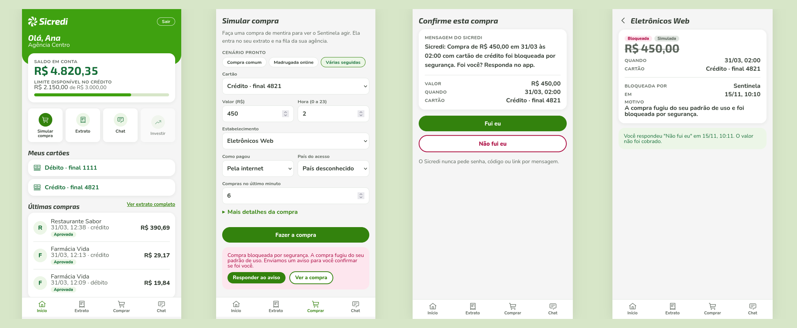

## Resultados em março de 2025

O modelo foi treinado com janeiro e fevereiro e testado em março, um mês que ele não viu.

| Indicador | Sentinela |
| --- | --- |
| Fraudes bloqueadas | **54 de 54** |
| Compras legítimas bloqueadas | **0** |
| Pedidos de confirmação | 159 (1,2% das compras) |
| Valor das compras fraudulentas barradas | R$ 13.490,70 (R$ 13.331,70 líquidos, descontado R$ 1,00 por confirmação) |
| Tempo de decisão | cerca de 1,5 ms |

> **Limites.** O modelo treinou com só 92 fraudes. A base é 100% sintética e muito separável:
> o modelo acerta tudo em março por isso, não por ser excepcional. Com dados reais, os números
> seriam menores. Detalhes na seção [Limites e próximos passos](#13-limites-e-próximos-passos).

## Veja funcionando

| Fila da agência e painel da compra (auditor) | Painel da matriz (todas as agências) |
| --- | --- |
| 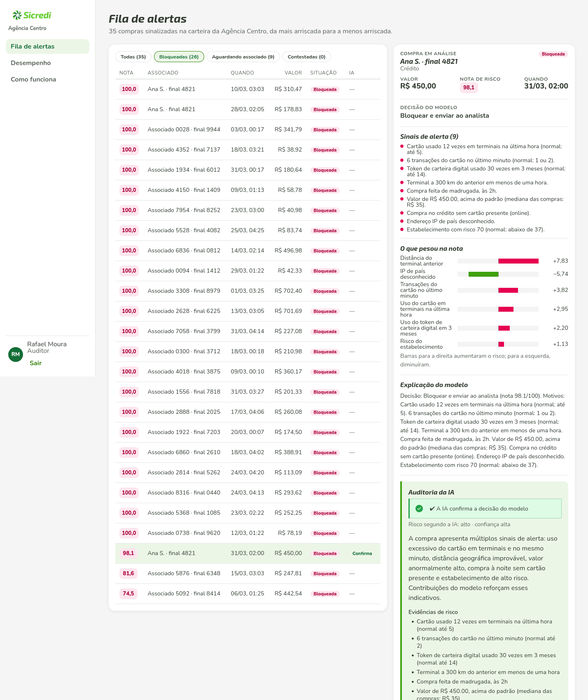 | 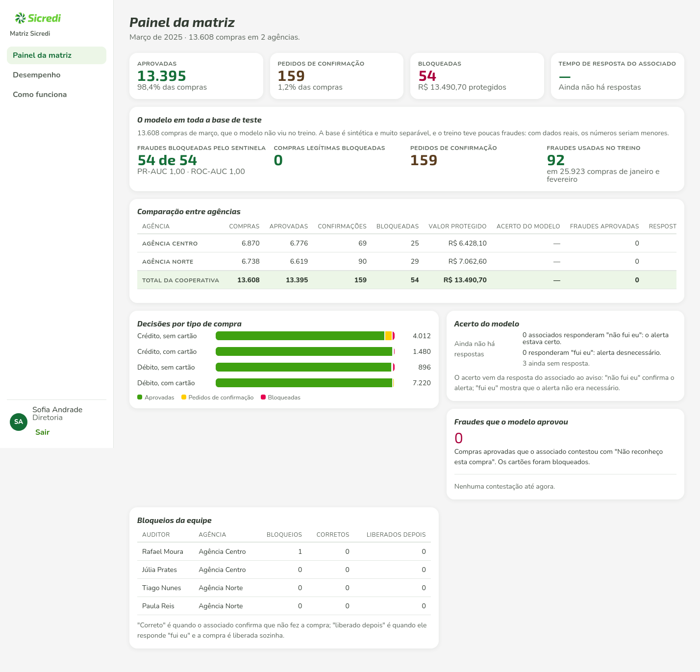 |

## Como rodar em 3 passos

Pré-requisitos: Python 3.14 e Node 22. Os dados sintéticos da Sicredi já vêm em `data/`.

```bash
# 1. API (na raiz do projeto)
python -m venv .venv && source .venv/bin/activate      # Windows: .venv\Scripts\activate
pip install -r requirements.txt -r requirements-dev.txt
uvicorn src.api.app:app --port 8000                    # documentação em http://localhost:8000/docs

# 2. Site (em outro terminal)
cd web && npm install && npm run dev                   # http://localhost:3000

# 3. Abra http://localhost:3000, escolha um perfil e clique em "Entrar"
```

O IBM watsonx.ai é opcional. Para ligá-lo, copie `.env.example` para `.env` e preencha as
credenciais (detalhes na [seção 10](#10-como-rodar-em-detalhes)). Sem elas, a auditoria e as
mensagens usam um modo local e todo o resto funciona igual.

---

# Manual completo

Do macro ao micro: o que o sistema faz, como as partes se comunicam, cada fluxo, os dados, o
modelo de machine learning e como tudo é testado.

1. [Visão geral](#1-visão-geral)
2. [Arquitetura](#2-arquitetura)
3. [Fluxos](#3-fluxos)
4. [As áreas do site](#4-as-áreas-do-site)
5. [Os dados](#5-os-dados)
6. [Machine learning](#6-machine-learning)
7. [A auditoria por IA](#7-a-auditoria-por-ia)
8. [API](#8-api)
9. [Privacidade e segurança](#9-privacidade-e-segurança)
10. [Como rodar em detalhes](#10-como-rodar-em-detalhes)
11. [Qualidade e testes](#11-qualidade-e-testes)
12. [Como usamos o IBM Bob](#12-como-usamos-o-ibm-bob)
13. [Limites e próximos passos](#13-limites-e-próximos-passos)
14. [Mapa da documentação](#14-mapa-da-documentação)

---

## 1. Visão geral

### O problema

Fraude em compras com cartão custa caro duas vezes: no dinheiro perdido e na confiança do
associado, que também se frustra quando uma compra legítima é negada. O desafio pede para
**prever e intervir**: decidir antes de a compra terminar e agir junto do associado.

### Quem usa o Sentinela

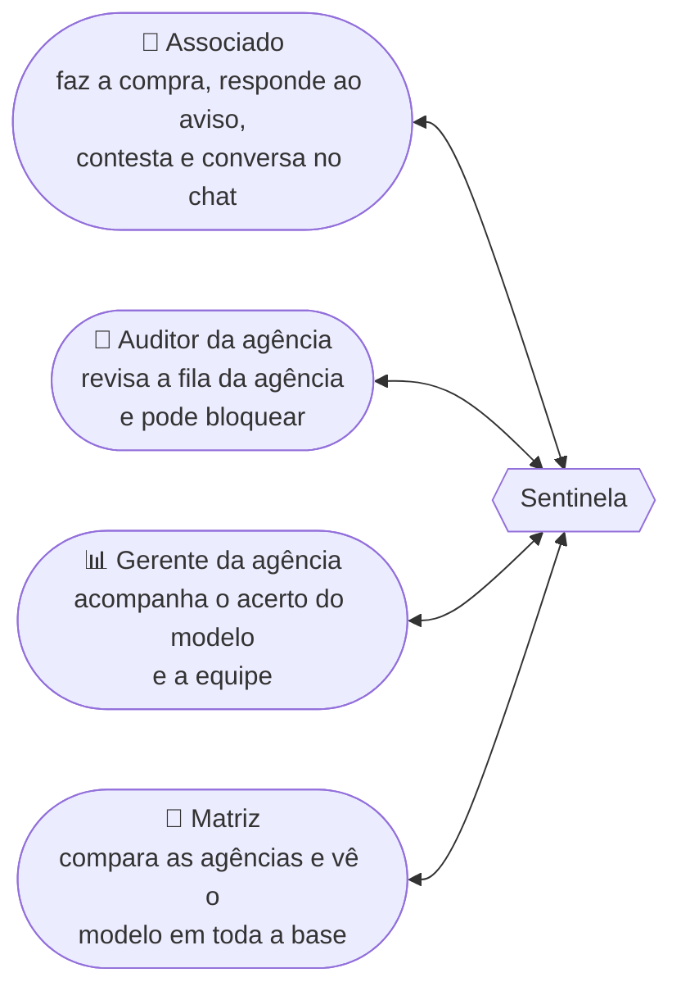

Cada perfil entra pela mesma tela de login simulado e vê só o que precisa:

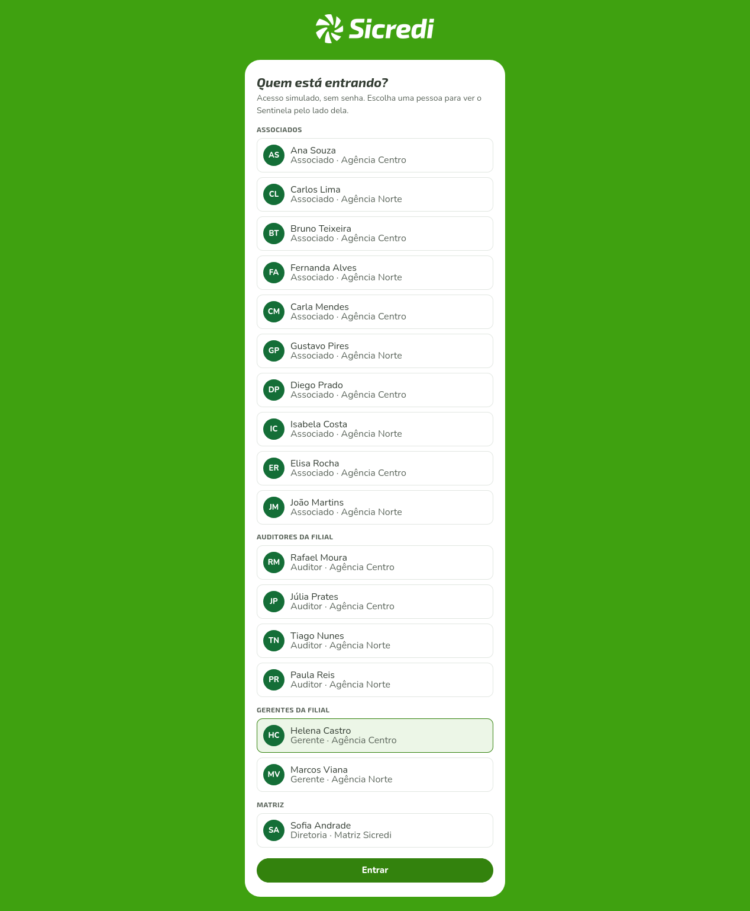

### O ciclo completo de uma compra

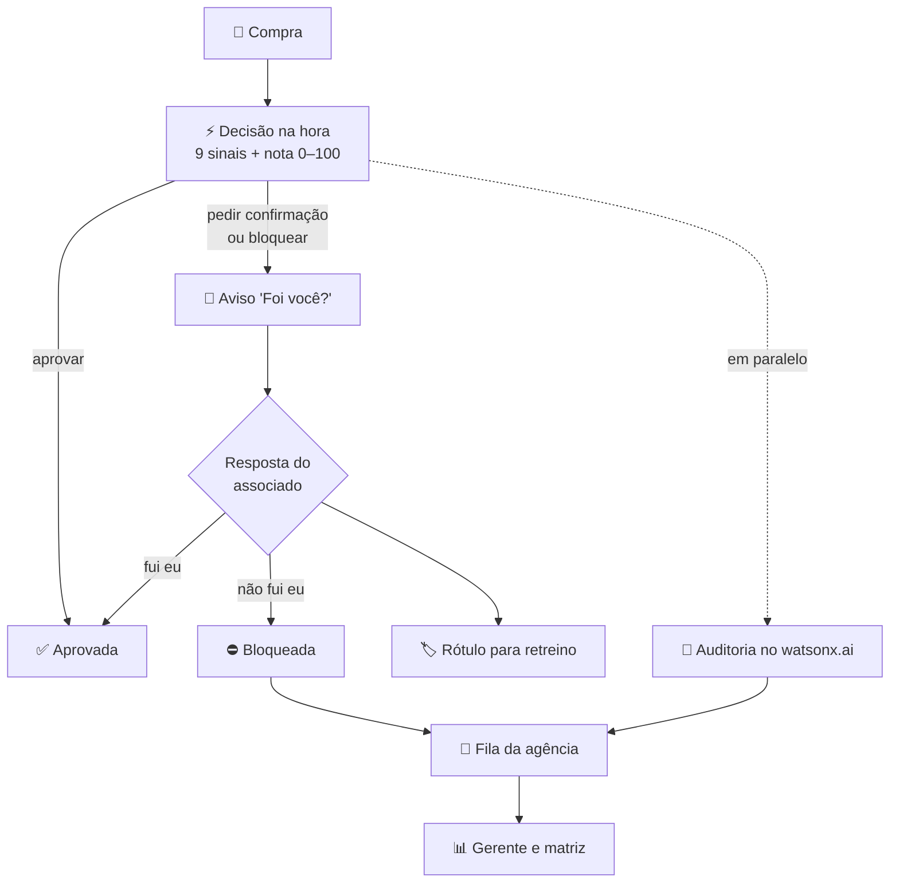

---

## 2. Arquitetura

Tudo roda na máquina de quem usa, com dados sintéticos. Só três coisas saem para o IBM
watsonx.ai, sempre sem identificadores: a auditoria da decisão, a redação do aviso ao associado e
as respostas do chat.

### 2.1 Contêineres

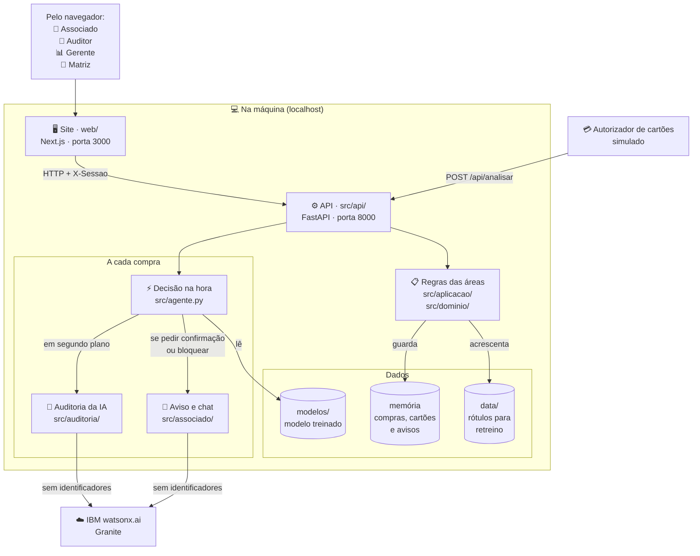

Leia de cima para baixo:

1. As quatro pessoas usam o **site**, e o site só fala com a **API**. O autorizador de cartões
   simulado também manda compras direto para a API.
2. A cada compra, a API **decide na hora** com o modelo treinado. Em paralelo, pede a
   **auditoria da IA** e o **aviso ao associado**, que o Granite redige no watsonx.ai. Sem
   credenciais, a auditoria roda no modo local e o aviso usa o modelo fixo.
3. As **regras das áreas** (associado, filial e matriz) guardam compras, cartões e avisos em
   memória, carregados de `data/` quando a API inicia, e acrescentam cada resposta do associado
   aos rótulos para retreino. Essas regras não sabem onde os dados ficam (seção 2.2).

### 2.2 Portas e adaptadores (as regras não dependem do armazenamento)

As regras do associado, da filial e da matriz conhecem só interfaces. Hoje o armazenamento é em
memória; os rótulos para retreino vão para um arquivo. Trocar por um banco de dados (Issue #107,
Postgres) é escrever um adaptador novo, sem mexer nas regras.

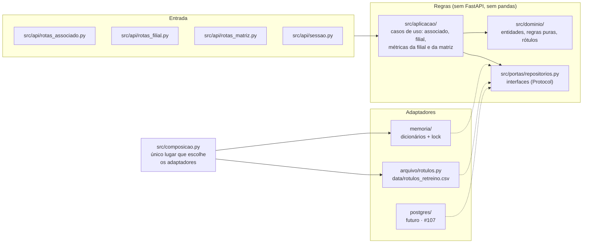

Um teste de arquitetura (`tests/test_dominio.py`) falha se algo em `src/dominio/` ou
`src/portas/` importar FastAPI, pandas ou um adaptador.

### 2.3 Estrutura de pastas

```
AGENTS.md            regras de trabalho do IBM Bob
ESPECIFICACAO.md     contrato: dados, modelo, agente, API, auditoria, canal e as três áreas
.bob/                modo personalizado do Bob (Auditor Sentinela)
src/
  preparar_dados.py  CSV da Sicredi → parquet com as 16 colunas permitidas
  treinar_modelo.py  regressão logística (jan–fev) → modelos/sentinela.joblib
  agente.py          sinais, nota e decisão; avaliar_agente.py confere março
  explicabilidade.py o que pesou na nota (coeficiente × valor padronizado)
  api/               FastAPI: app, sessão, rotas do associado, da filial e da matriz
  dominio/           entidades e regras puras (situação, saldo, rótulos)
  aplicacao/         casos de uso do associado, da filial e das métricas
  portas/            interfaces dos repositórios
  adaptadores/       memória e arquivo de rótulos; composicao.py liga tudo
  auditoria/         agente auditor: ferramentas, watsonx.ai, modo local, relatório
  associado/         avisos, mensagem pelo Granite e chat
  analisar_*.py      scripts de análise que gravam JSON em modelos/
  exportar_retreino.py  rótulos → data/retreino.parquet
web/
  app/               páginas: entrar/, associado/, filial/, matriz/
  components/        componentes por área e comuns/
  lib/               cliente da API, tipos, textos, sessão, mocks
  styles/sicredi.scss  identidade visual da Sicredi
tests/               pytest; test_conformidade_*.py são a régua de "pronto"
modelos/             modelo treinado e resultados das análises (versionados)
docs/                arquitetura, decisões, avaliação, análise exploratória, privacidade, imagens
data/                dados sintéticos da Sicredi (CSV comprimido, dicionário, parquet)
```

### 2.4 Tecnologias

| Camada | Tecnologia | Para quê |
| --- | --- | --- |
| Dados e modelo | Python 3.14, pandas, scikit-learn | Preparar a base, treinar e avaliar a regressão logística |
| IA generativa | IBM watsonx.ai, IBM Granite (`ibm/granite-4-h-small`) | Auditoria com ferramentas, aviso ao associado e chat |
| API | FastAPI, Uvicorn | Decisão em milissegundos, sessão e rotas das três áreas |
| Site | Next.js 16, React 19, IBM Carbon, identidade Sicredi (Exo 2 e Nunito) | App do associado (celular) e áreas da agência e da matriz (desktop) |
| Qualidade | pytest, Black, Ruff, Vitest, ESLint, TypeScript, GitHub Actions | Portão de qualidade em todo Pull Request |
| Desenvolvimento | IBM Bob | Planejamento, detalhamento e execução das Issues |

As escolhas estão registradas em 17 decisões de arquitetura ([docs/decisoes.md](docs/decisoes.md)).

---

## 3. Fluxos

### 3.1 Uma compra suspeita, do começo ao fim

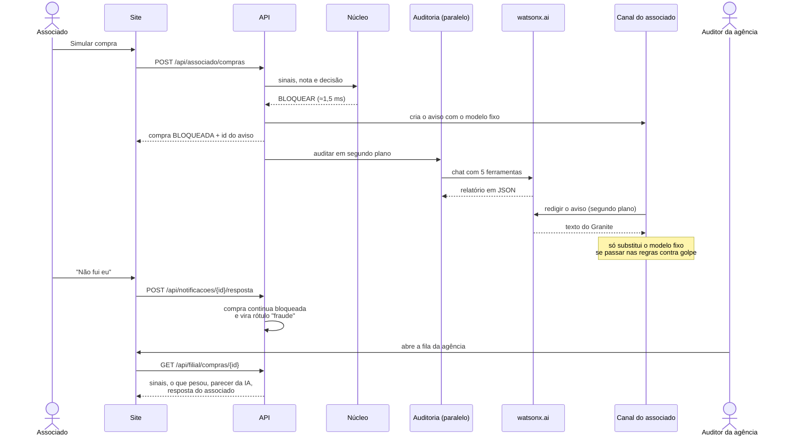

### 3.2 As situações de uma compra

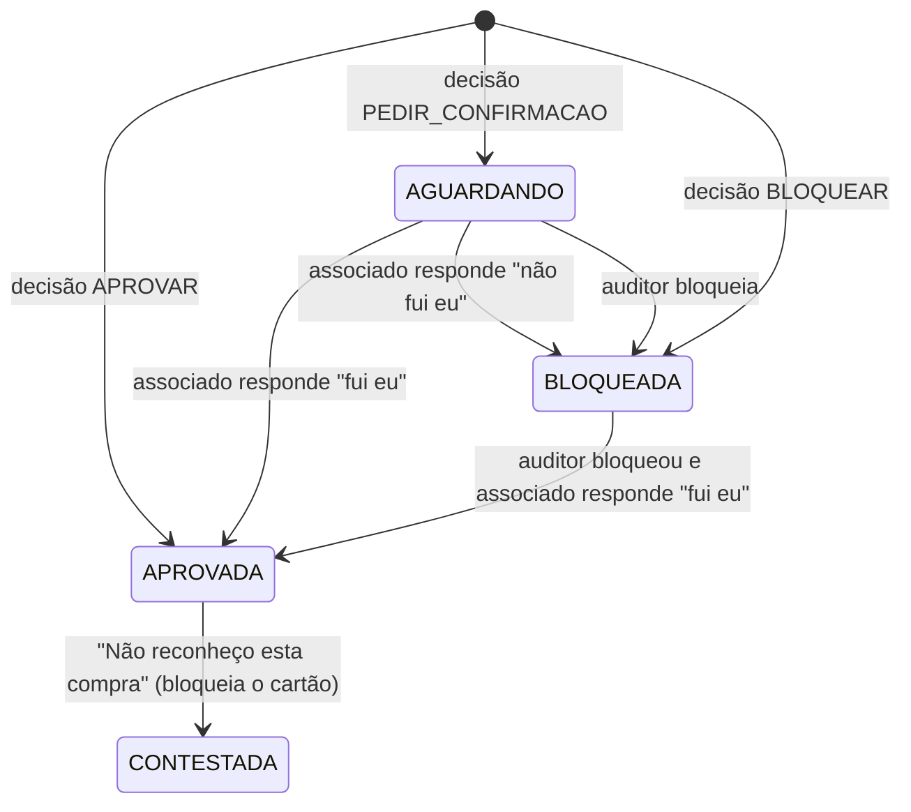

- **Saldo e limite:** só compras simuladas que viram `APROVADA` mexem neles (débito desconta o
  saldo; crédito consome o limite), uma única vez. A contestação devolve o valor.
- **Bloqueio do Sentinela:** fica bloqueado mesmo se o associado disser "fui eu"; o caso vai para
  a agência.

### 3.3 O auditor bloqueia e a liberação automática

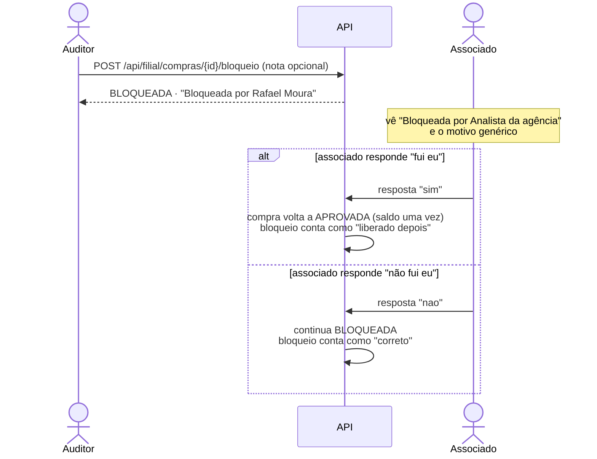

### 3.4 O aviso ao associado

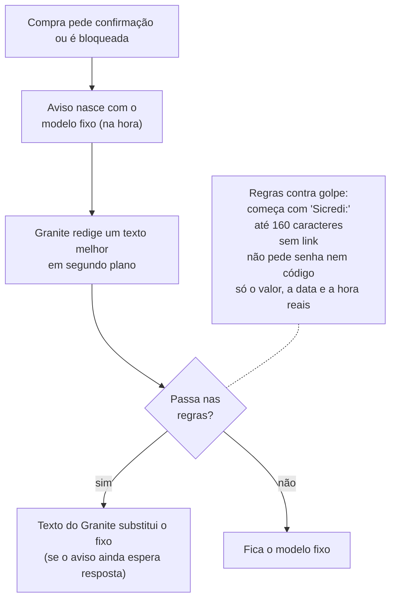

### 3.5 Do retorno do associado ao retreino

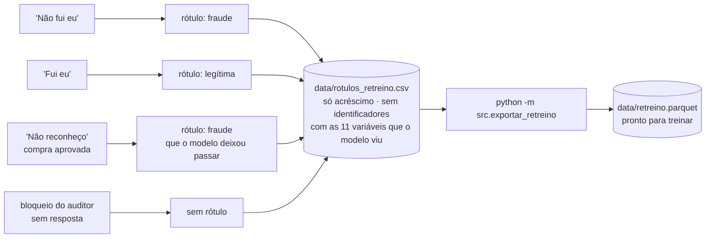

O retreino em si fica fora desta entrega: o modelo campeão não muda.

---

## 4. As áreas do site

### 4.1 Associado (celular)

| Tela | O que tem |
| --- | --- |
| Início | Saldo, limite disponível, cartões, atalhos, avisos pendentes e as últimas compras |
| Simular compra | Três cenários prontos (compra comum, madrugada online, várias seguidas) e o formulário completo |
| "Foi você?" | Mensagem do Sicredi, valor, quando, cartão e os botões "Fui eu" e "Não fui eu" |
| Detalhe da compra | Situação, quem bloqueou, quando e o motivo genérico; "Não reconheço esta compra" nas aprovadas |
| Extrato | Compras agrupadas por mês, com filtros por situação |
| Chat | Perguntas sobre gastos e compras bloqueadas, respondidas pelo Granite; "Conversar com gerente" (simulado) |

| Extrato | Chat com o Granite |
| --- | --- |
| 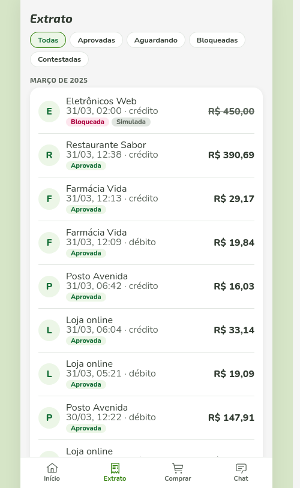 | 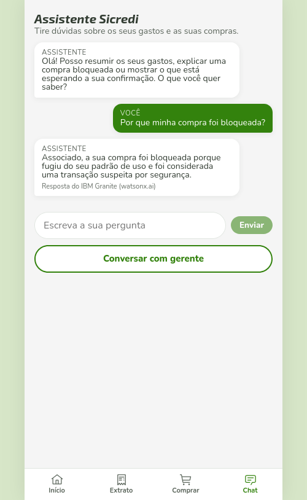 |

### 4.2 Agência: auditor e gerente (desktop)

O auditor vê a fila só da própria agência, ordenada pela nota. No painel da compra estão os
sinais, o que pesou na nota, a explicação, o parecer da IA, a resposta do associado e o histórico
agregado. Ele pode bloquear uma compra que ainda espera o associado.

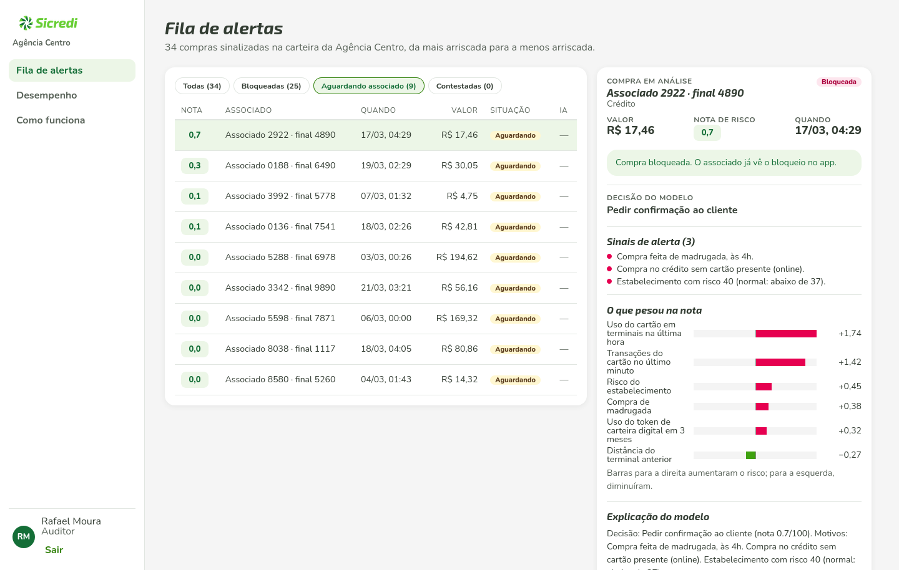

O gerente acompanha a agência: decisões por tipo de compra, acerto do modelo pelas respostas dos
associados, fraudes que o modelo aprovou (contestações) e os bloqueios de cada auditor.

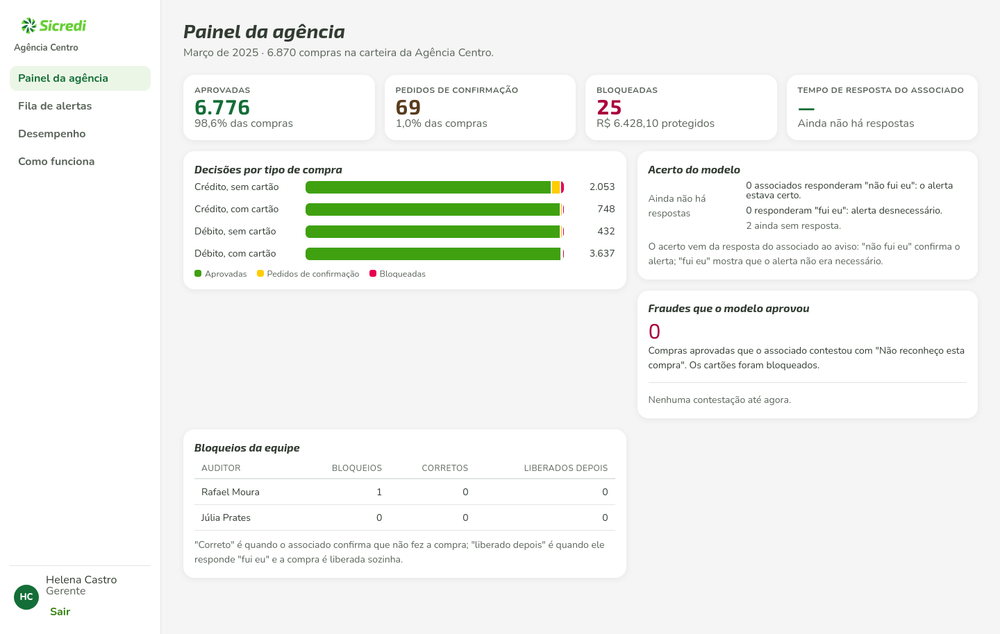

### 4.3 Matriz (desktop)

A matriz soma as agências, compara uma com a outra e mostra o modelo em toda a base de teste
(veja a imagem em [Veja funcionando](#veja-funcionando)).

### 4.4 Desempenho e Como funciona

| Desempenho | Como funciona |
| --- | --- |
| 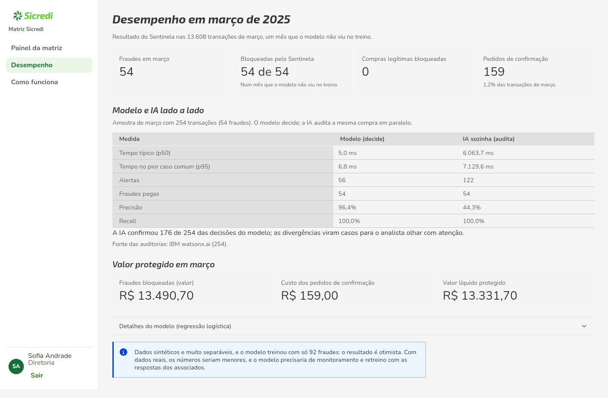 | 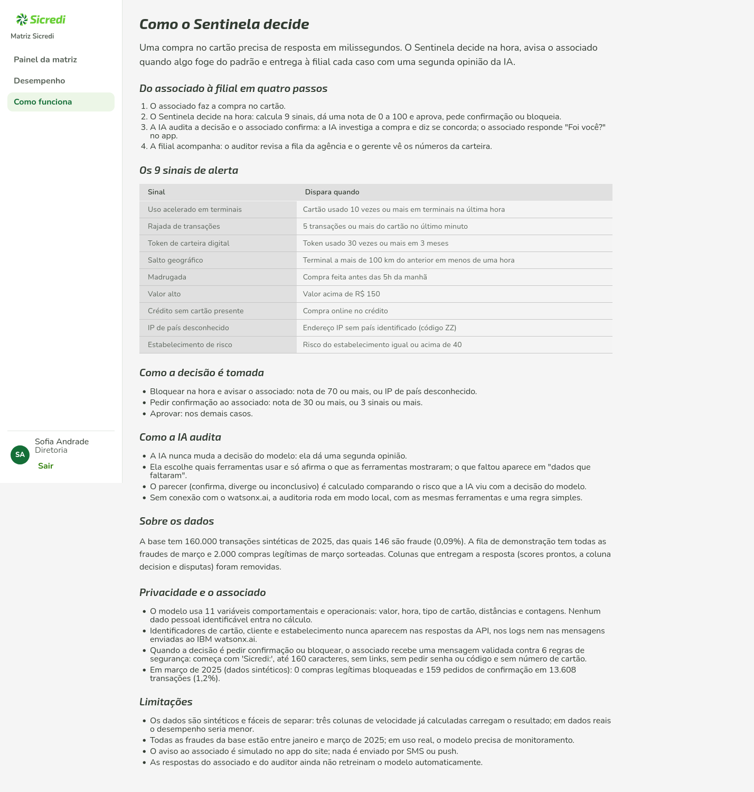 |

---

## 5. Os dados

### 5.1 A base

A Sicredi forneceu uma base sintética de compras com cartão de 2025: **160.000 compras e 146
fraudes (0,09%)**, com 297 colunas. O rótulo é `feedback_label`; a coluna `fraud` tem erros
sistemáticos e não é usada. A base recebida difere da descrita nas orientações (900.000 linhas e
900 fraudes), e **todas as fraudes estão entre janeiro e março**.

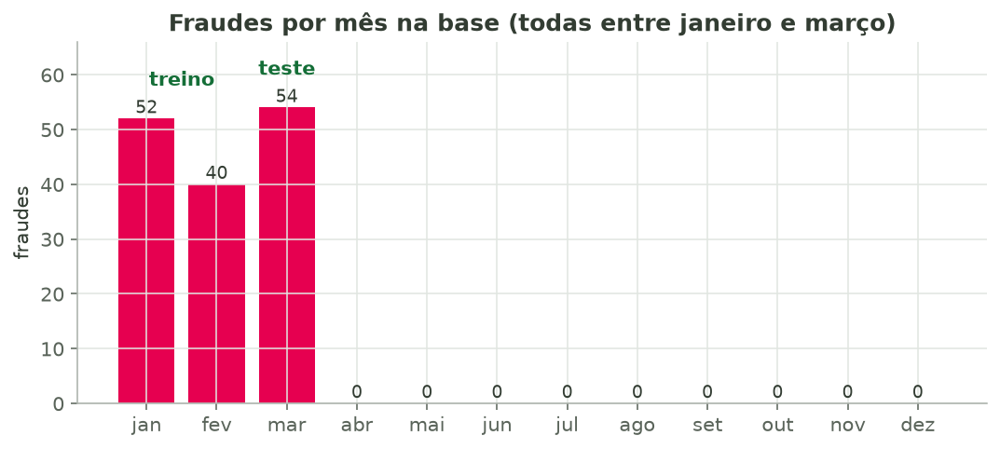

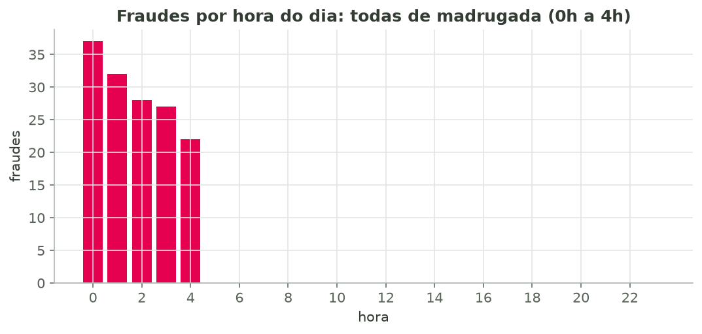

- **Todas** as 146 fraudes são de madrugada (0h a 4h); 124 foram no crédito e 135 sem cartão
  presente.
- Detalhes, com estatísticas por variável: [docs/analise-exploratoria.md](docs/analise-exploratoria.md).

### 5.2 O que entra e o que nunca entra

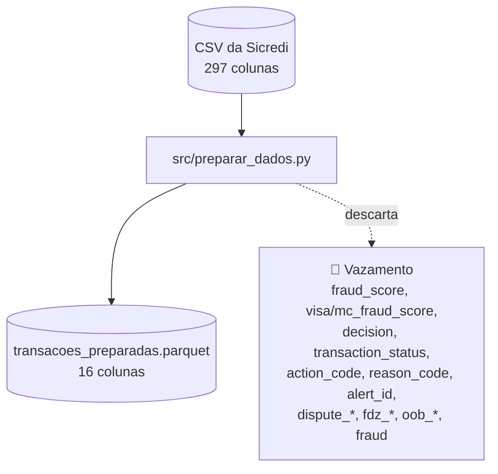

As colunas descartadas entregariam a resposta ou só existem depois da decisão. A coluna
`decision` (approve/deny) é um campo sintético que o dicionário não documenta como a decisão de
um sistema real, e todo "deny" nela é fraude; por isso ela não é usada nem como comparação.

---

## 6. Machine learning

### 6.1 O pipeline

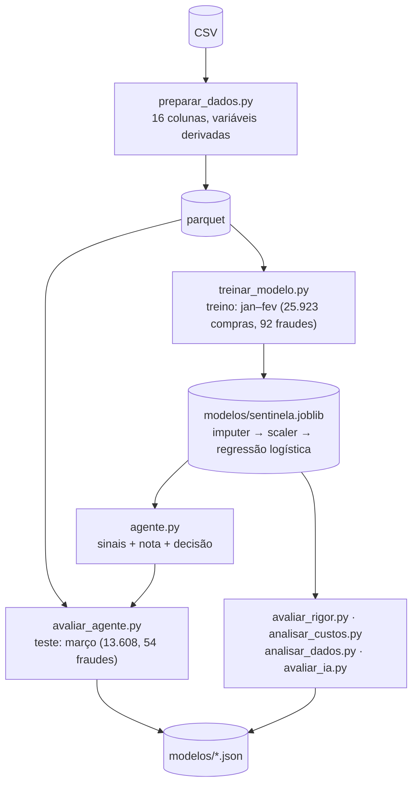

### 6.2 As 11 variáveis do modelo

| Variável | O que é |
| --- | --- |
| `valor` | Valor da compra em reais |
| `hora` | Hora do dia (0 a 23) |
| `madrugada` | 1 se a compra foi antes das 5h |
| `credito` | 1 se foi no crédito |
| `nao_presente` | 1 se o cartão não estava presente (compra online) |
| `ip_pais_desconhecido` | 1 se o IP não tem país identificado |
| `vel_cartao_terminal_1h` | Usos do cartão em terminais na última hora |
| `qtd_transacoes_cartao_1min` | Compras do cartão no último minuto |
| `qtd_token_carteira_3m` | Usos da carteira digital em 3 meses |
| `dist_terminal_anterior_km` | Distância do terminal da compra anterior |
| `risco_estabelecimento` | Risco do estabelecimento (0 a 100) |

### 6.3 Os 9 sinais de alerta

Regras simples e explicáveis, calculadas antes da nota:

| Sinal | Dispara quando |
| --- | --- |
| Uso acelerado em terminais | Cartão usado 10 vezes ou mais em terminais na última hora |
| Rajada no último minuto | 5 compras ou mais do cartão no último minuto |
| Carteira digital muito usada | 30 usos ou mais do token em 3 meses |
| Salto geográfico | Terminal a mais de 100 km do anterior |
| Madrugada | Compra entre 0h e 4h |
| Valor alto | Valor acima de R$ 150 |
| Crédito sem cartão presente | Compra online no crédito |
| IP de país desconhecido | Endereço IP sem país identificado |
| Estabelecimento de risco | Risco do estabelecimento de 40 ou mais |

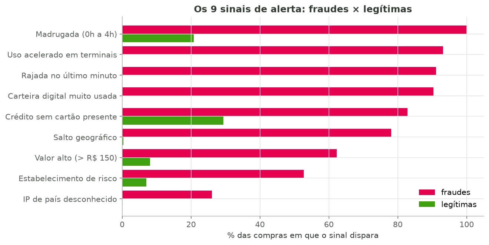

Os três sinais de velocidade aparecem em mais de 90% das fraudes e em quase nenhuma compra
legítima. Madrugada e crédito sem cartão aparecem em todas ou quase todas as fraudes, mas também
em muitas compras normais; sozinhos não bastam.

### 6.4 O modelo: regressão logística

O modelo é um pipeline de três passos: preenche vazios (`imputer`), padroniza as variáveis
(`scaler`) e aplica a **regressão logística**, que dá a probabilidade de fraude. A nota é essa
probabilidade em escala de 0 a 100. A escolha (ADR-003): ela empatou com um gradient boosting e
explica a nota variável por variável.

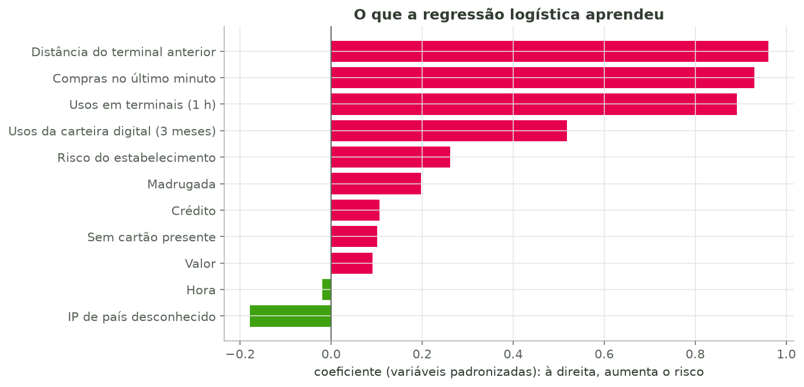

As variáveis de velocidade e a distância entre terminais são as que mais aumentam o risco.

### 6.5 Da nota à decisão

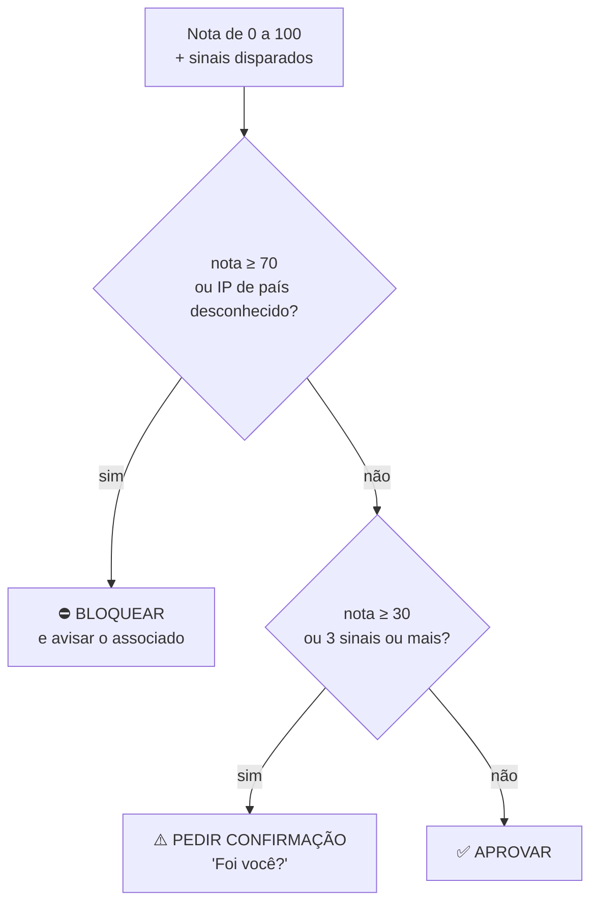

A regra dos 3 sinais é uma margem de segurança: em março, ela gerou os 159 pedidos de confirmação
(nenhuma fraude entre eles), para quando os dados reais não forem tão separáveis.

### 6.6 O que pesou na nota

Para cada compra, a contribuição de cada variável é `coeficiente × valor padronizado`; a soma das
contribuições mais o intercepto é o log-odds da nota. O auditor vê exatamente o que empurrou a
nota para cima (vermelho) ou para baixo (verde), e a IA usa a mesma informação como ferramenta.

### 6.7 Avaliação com rigor

Tudo em [docs/avaliacao.md](docs/avaliacao.md), gerado por `python -m src.avaliar_rigor` e
`python -m src.analisar_custos`.

- **Validação temporal** em duas janelas (jan → fev e jan–fev → mar): PR-AUC 1,00 nas duas.
- **Bootstrap** com 1.000 reamostras: recall e precisão de 100% em todas.
- **Comparação de abordagens:**

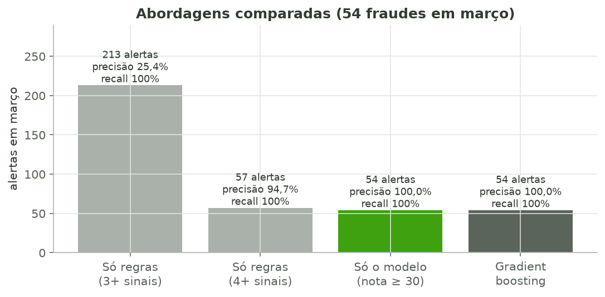

- **Ablação:** tirar qualquer variável sozinha não muda nada; tirar as três de velocidade juntas
  derruba a PR-AUC para 0,861. Elas carregam o sinal.

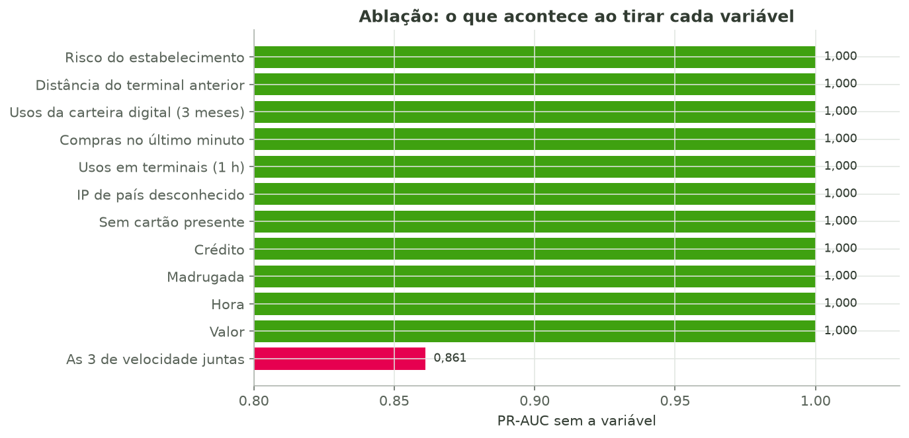

- **Calibração:** Brier 0,000007. As 13.554 compras legítimas têm nota abaixo de 10; as 54
  fraudes, acima de 70.

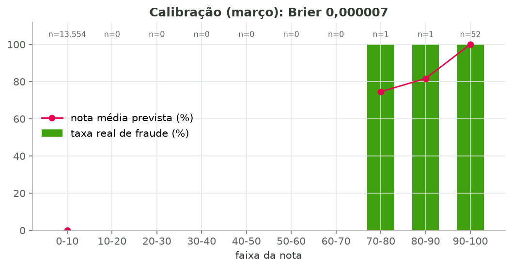

- **Nota de corte:** de 5 a 70, as 54 fraudes ficam acima do corte com só 54 alertas do modelo.

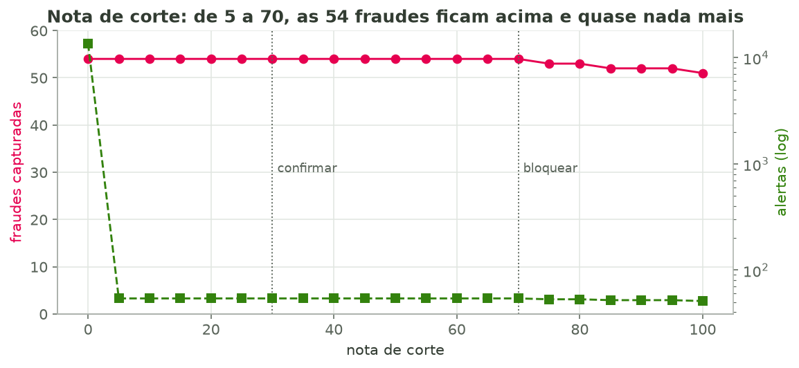

---

## 7. A auditoria por IA

### 7.1 Como o agente auditor trabalha

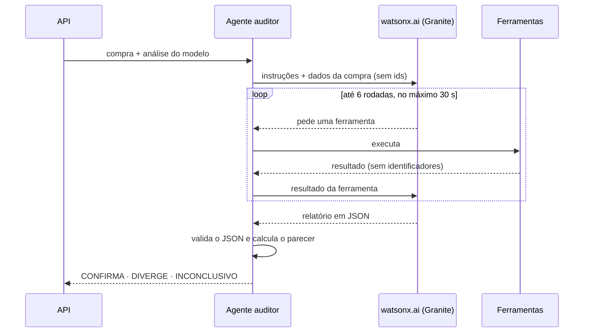

| Ferramenta | O que devolve |
| --- | --- |
| `sinais_da_transacao` | Sinais disparados e campos vazios da compra |
| `contribuicoes_da_nota` | Variáveis que mais aumentaram ou diminuíram a nota |
| `historico_do_cartao` | Resumo das últimas compras do mesmo cartão |
| `perfil_do_cliente` | Padrão de gasto do cliente antes desta compra |
| `perfil_do_estabelecimento` | Padrão das compras no mesmo estabelecimento |

O relatório traz o risco segundo a IA (baixo, suspeito ou alto), a confiança, a explicação, as
evidências a favor e contra e os dados que faltaram. O **parecer** compara o risco da IA com a
decisão do modelo: confirma, diverge ou é inconclusivo (sem risco ou com confiança baixa). Sem
credenciais ou se o watsonx.ai falhar, o **modo local** aplica a regra dos sinais e nada para.

### 7.2 Por que o modelo decide e a IA audita

Em 254 compras de março (as 54 fraudes e 200 legítimas), todas auditadas pelo watsonx.ai:

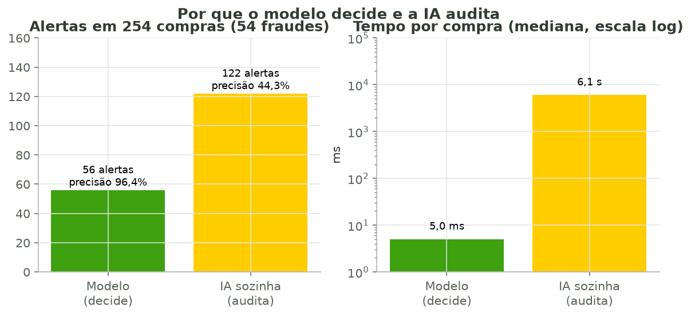

As duas acham as 54 fraudes, mas a IA sozinha alerta mais que o dobro e é mil vezes mais lenta.
Uma compra com cartão precisa de resposta em milissegundos: o modelo decide e a IA audita
(ADR-012). A IA concorda com 88,9% dos bloqueios e com 100% dos pedidos de confirmação.

---

## 8. API

Documentação interativa em http://localhost:8000/docs. Contrato completo na
[ESPECIFICACAO.md](ESPECIFICACAO.md), seções 12 a 17.

| Grupo | Rotas |
| --- | --- |
| Núcleo | `GET /api/saude` · `POST /api/analisar` · `GET /api/fila` · `GET /api/transacoes/{id}` · `GET /api/metricas` |
| Auditoria | `POST /api/transacoes/{id}/auditoria` · `GET /api/auditorias/{id}` |
| Avisos | `GET /api/notificacoes` · `GET /api/notificacoes/{id}` · `POST /api/notificacoes/{id}/resposta` |
| Sessão | `GET /api/sessao/perfis` · `POST /api/sessao` (devolve o token do cabeçalho `X-Sessao`) |
| Associado | `GET /api/associado/inicio` · `GET /api/associado/extrato` · `GET /api/associado/compras/{id}` · `POST /api/associado/compras` · `POST /api/associado/compras/{id}/contestacao` · `POST /api/associado/chat` · `POST /api/associado/chat/gerente` |
| Filial | `GET /api/filial/fila` · `GET /api/filial/compras/{id}` · `POST /api/filial/compras/{id}/bloqueio` · `GET /api/filial/metricas` |
| Matriz | `GET /api/matriz/metricas` |

Exemplo, decisão de uma compra:

```bash
curl -s -X POST localhost:8000/api/analisar -H 'Content-Type: application/json' \
  -d '{"valor": 450, "hora": 2, "madrugada": 1, "credito": 1, "nao_presente": 1,
       "ip_pais_desconhecido": 1, "qtd_transacoes_cartao_1min": 6, "vel_cartao_terminal_1h": 12,
       "qtd_token_carteira_3m": 30, "dist_terminal_anterior_km": 300, "risco_estabelecimento": 70}'
```

---

## 9. Privacidade e segurança

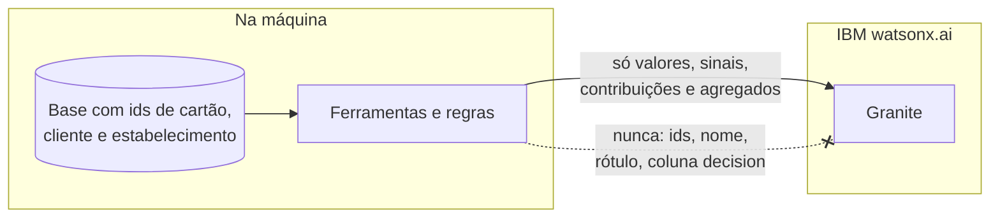

| Perfil | Vê | Não vê |
| --- | --- | --- |
| Associado | As próprias compras, com motivo genérico; "Analista da agência" quando um auditor bloqueou | Sinais, nota, parecer da IA e o nome do auditor |
| Auditor | A fila da agência com nome abreviado e final do cartão, o detalhe técnico e o histórico agregado | Saldo, extrato e nome completo do associado; outras agências |
| Gerente | O mesmo que o auditor, mais as métricas da agência | Outras agências |
| Matriz | Os números de todas as agências | A fila e o detalhe das compras |

- **Regras contra golpe** em toda mensagem ao associado: começa com "Sicredi:", até 160
  caracteres, sem link, nunca pede senha, código ou dados do cartão.
- **Credenciais** só no `.env`, que não vai para o Git e que o Bob não pode ler.
- Detalhes em [docs/privacidade.md](docs/privacidade.md).

---

## 10. Como rodar em detalhes

### 10.1 watsonx.ai

```bash
cp .env.example .env
```

Preencha no `.env`:

| Variável | O que é |
| --- | --- |
| `WATSONX_APIKEY` | API key do IBM Cloud |
| `WATSONX_PROJECT_ID` | ID do projeto no watsonx.ai |
| `WATSONX_URL` | URL da região (por exemplo, `https://us-south.ml.cloud.ibm.com`) |
| `WATSONX_MODELO` | `ibm/granite-4-h-small` |

Confira em http://localhost:8000/api/saude: `"auditoria": "watsonx"` quando o `.env` foi lido;
`"local"` quando não foi.

### 10.2 Perfis para entrar (sem senha)

| Agência | Gerente | Auditores | Associados |
| --- | --- | --- | --- |
| Centro | Helena Castro | Rafael Moura, Júlia Prates | Ana Souza, Bruno Teixeira, Carla Mendes, Diego Prado, Elisa Rocha |
| Norte | Marcos Viana | Tiago Nunes, Paula Reis | Carlos Lima, Fernanda Alves, Gustavo Pires, Isabela Costa, João Martins |
| Matriz | Sofia Andrade (diretoria) | — | — |

Os nomes, saldos e agências são fictícios; cada associado está ligado a um cliente real de março
da base, para ter extrato e histórico.

### 10.3 Outras formas de rodar

```bash
cd web && NEXT_PUBLIC_USAR_MOCK=1 npm run dev       # site sem a API, com dados de exemplo
cd web && npm run build && npx next start -p 3000  # site em modo de produção
```

O estado (compras simuladas, avisos, bloqueios) fica em memória: reiniciar a API volta tudo ao
começo. Os rótulos para retreino ficam em `data/rotulos_retreino.csv`.

### 10.4 Scripts

```bash
python -m src.preparar_dados      # CSV → data/transacoes_preparadas.parquet
                                  # (antes: gunzip -k data/case_transacoes_cartoes_sintetico_900k.csv.gz)
python -m src.treinar_modelo      # modelos/sentinela.joblib e metricas.json
python -m src.avaliar_agente      # confere os números de março
python -m src.analisar_dados      # modelos/eda.json e docs/analise-exploratoria.md
python -m src.avaliar_rigor       # modelos/avaliacao_rigorosa.json
python -m src.analisar_custos     # modelos/custos.json
python -m src.avaliar_ia          # modelos/ia_contra_modelo.json (precisa do .env; ~30 min)
python -m src.exportar_retreino   # data/retreino.parquet a partir dos rótulos
```

---

## 11. Qualidade e testes

```bash
python -m black --check . && python -m ruff check . && python -m pytest -q
python -m src.avaliar_agente
cd web && npm run lint && npm run typecheck && npm test && npm run build
```

- **473 testes Python** e **99 testes do site**, rodados pelo CI "Qualidade" (GitHub Actions) em
  todo Pull Request.
- **Testes de conformidade** (`tests/test_conformidade_nucleo.py` e
  `tests/test_conformidade_api.py`): a régua de "pronto". Conferem os números exatos do modelo, as
  colunas proibidas, as bordas da decisão, a reprodutibilidade e o contrato da API.
- **Testes de contrato** das áreas do associado, da filial e da matriz
  (`tests/test_contrato_refatoracao.py`).

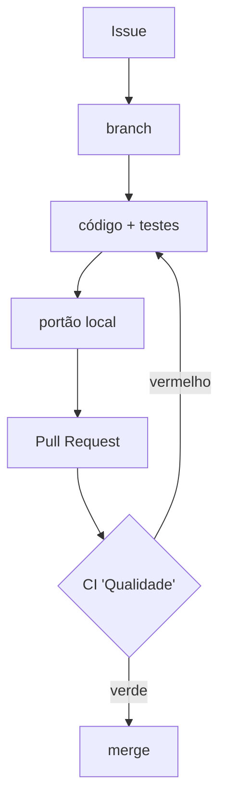

---

## 12. Como usamos o IBM Bob

O IBM Bob foi o planejador e o executor do projeto. Planejamos a arquitetura e o backlog com ele,
detalhamos cada Issue com ele e cada integrante executou as suas no modo Agent, sempre a partir
dos mesmos arquivos de contexto:

- **[`AGENTS.md`](AGENTS.md):** o protocolo de 9 passos por Issue, padrões de código, privacidade e
  quando parar e perguntar.
- **[`ESPECIFICACAO.md`](ESPECIFICACAO.md):** o contrato com os números exatos.
- **[`docs/backlog.md`](docs/backlog.md):** cada Issue com arquivos permitidos e critérios de
  aceite.
- **`.bobignore`:** impede o Bob de abrir os dados e as credenciais.
- **`.bob/custom_modes.yaml`:** o modo "Auditor Sentinela", que roda o portão sem editar nada.

Os testes de conformidade, que o Bob é proibido de alterar, dizem quando uma Issue está pronta.

---

## 13. Limites e próximos passos

- **Dados sintéticos e muito separáveis.** O modelo treinou com só 92 fraudes; o 54 de 54 vem da
  base, não de um modelo excepcional. Com dados reais, os números seriam menores.
- **Base diferente da descrita.** 160.000 linhas e 146 fraudes, contra 900.000 e 900 nas
  orientações; fraudes só entre janeiro e março.
- **Simulações.** O app do associado, o login e a conversa com o gerente são simulados; em
  produção, o aviso iria por SMS ou push.
- **Estado em memória.** Reiniciar a API apaga compras simuladas, avisos e bloqueios.

Próximos passos: banco de dados por um adaptador novo (Issue #107), retreino periódico com os
rótulos coletados, monitoramento de deriva e integração com um canal real de aviso.

---

## 14. Mapa da documentação

| Arquivo | Conteúdo |
| --- | --- |
| [ESPECIFICACAO.md](ESPECIFICACAO.md) | Contrato: dados, modelo, agente, API, auditoria, canal e as três áreas |
| [docs/arquitetura.md](docs/arquitetura.md) | Contêineres e o fluxo de uma compra suspeita |
| [docs/decisoes.md](docs/decisoes.md) | As 17 decisões de arquitetura (ADRs) |
| [docs/analise-exploratoria.md](docs/analise-exploratoria.md) | O que os dados mostram |
| [docs/avaliacao.md](docs/avaliacao.md) | Janelas temporais, bootstrap, abordagens, ablação, calibração e custo |
| [docs/privacidade.md](docs/privacidade.md) | O que o Sentinela lê, o que vai para a IA e o que cada perfil vê |
| [docs/requisitos.md](docs/requisitos.md) | O que o desafio pede e como cada item é atendido |
| [docs/backlog.md](docs/backlog.md) | Issues, donos e critérios de aceite |
| [docs/prototipo/index.html](docs/prototipo/index.html) | Protótipo de alta fidelidade do visual |
