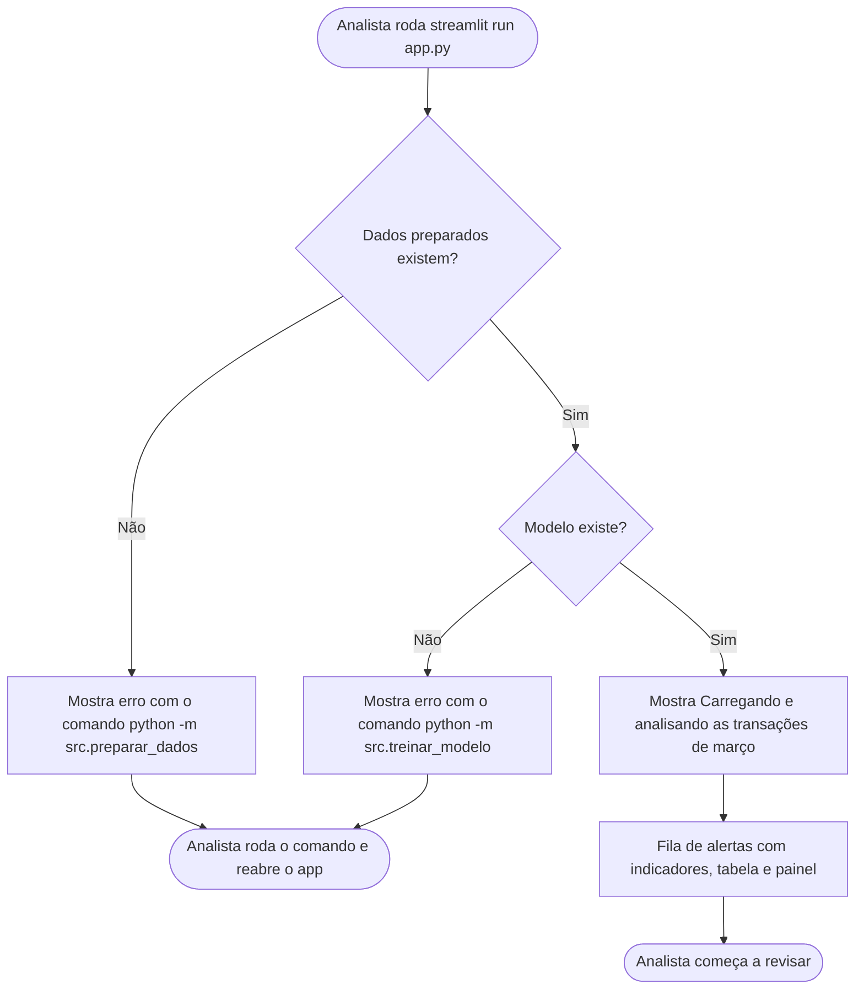
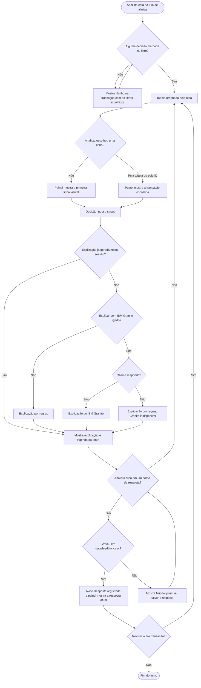

# 03 — User Flows

Um diagrama por jornada. Cada cenário das histórias US005 a US007 tem um caminho aqui; os
caminhos de erro estão desenhados, não subentendidos.

## Jornada 1 — Abrir o Sentinela (US005, cenários 1, 5 e 6)

## Jornada 2 — Revisar um alerta (US005 cenários 2 a 4, US006, US007)

