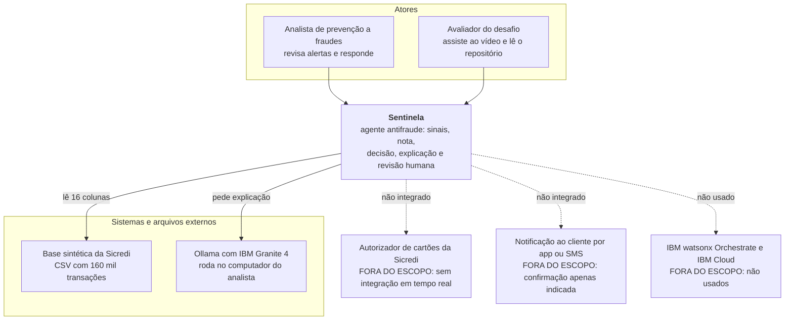
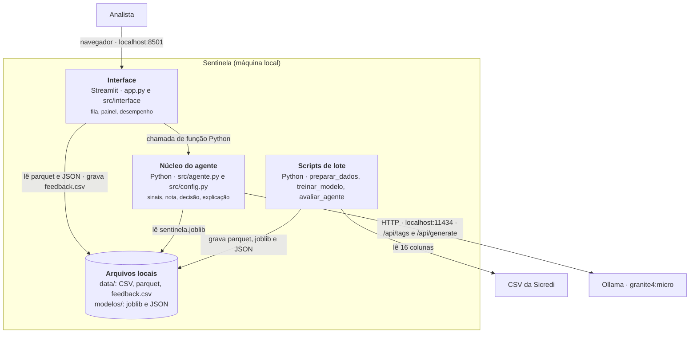
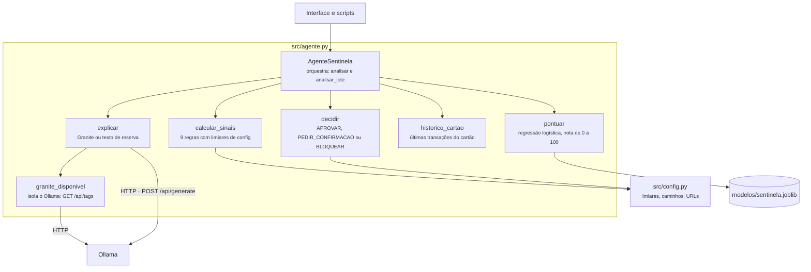

# 04 — Arquitetura (C4)

O Sentinela roda inteiro na máquina de quem o usa: uma interface Streamlit, um núcleo de agente
em Python, scripts de preparação e treino, arquivos locais e o IBM Granite servido pelo Ollama.
Nada é hospedado (ADR-002).

## Nível 1 — Contexto

## Nível 2 — Contêineres

## Nível 3 — Componentes do núcleo do agente

O núcleo concentra a regra de negócio: se ele errar, o produto inteiro erra.

Regra de manutenção: um Pull Request que muda assinatura pública do agente, cria módulo ou
adiciona dependência externa atualiza este arquivo no mesmo Pull Request.
