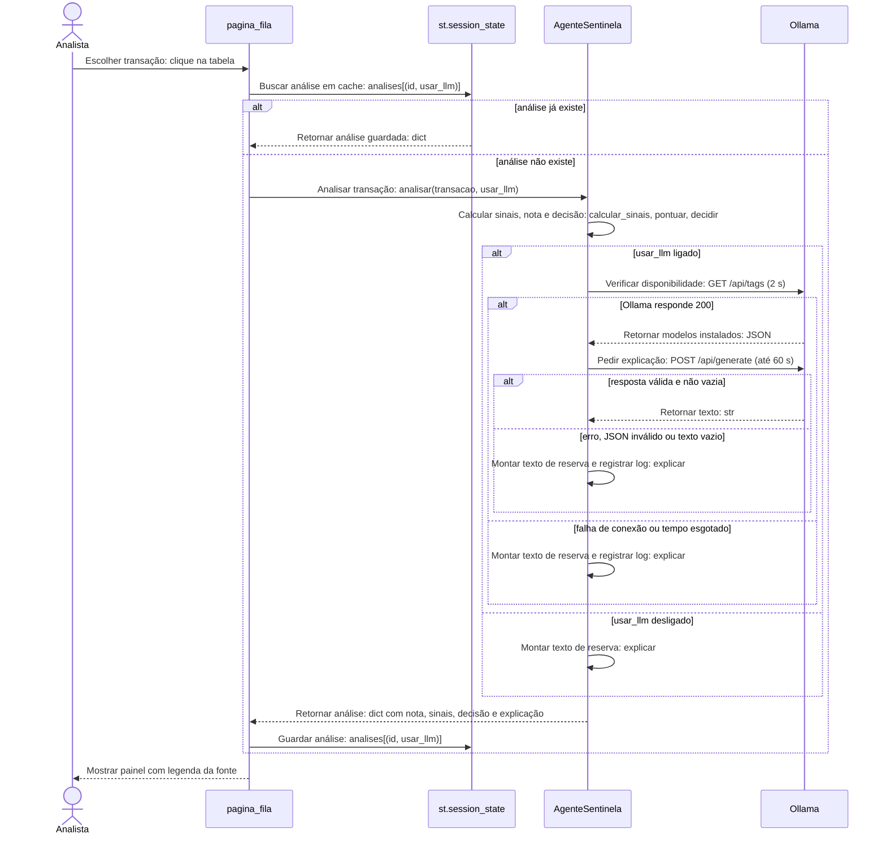
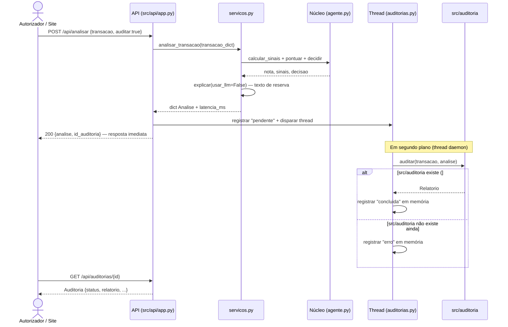
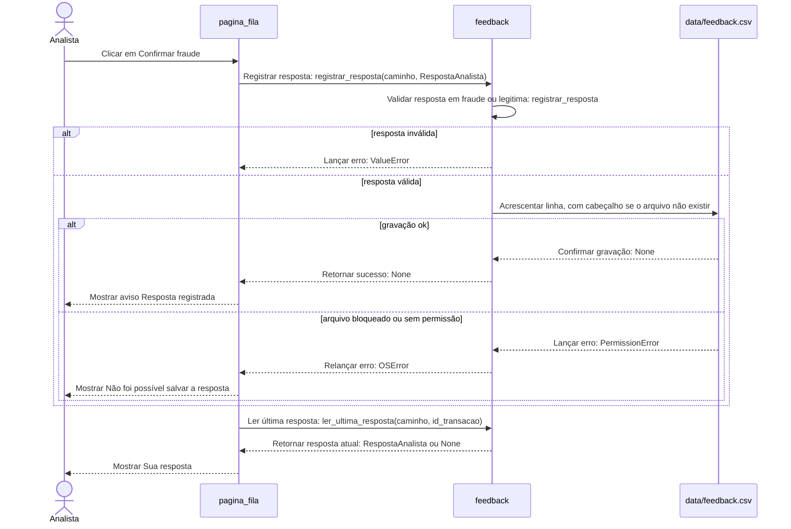

# 06 — Diagramas de sequência

Só os fluxos que acionam os gatilhos do Manual (2.4.5): integração externa (Ollama) e operação
que o usuário pode repetir (clique duplo no botão de resposta).

## Analisar e explicar uma transação (US006, cenários 6 a 9)

## Decisão imediata e auditoria em paralelo (Issue #38)

## Registrar a resposta do analista (US007)

O clique pode se repetir (duplo clique, ou o analista muda de ideia). Cada clique acrescenta
uma linha; a leitura usa sempre a última linha da transação, então repetir não muda o resultado.

