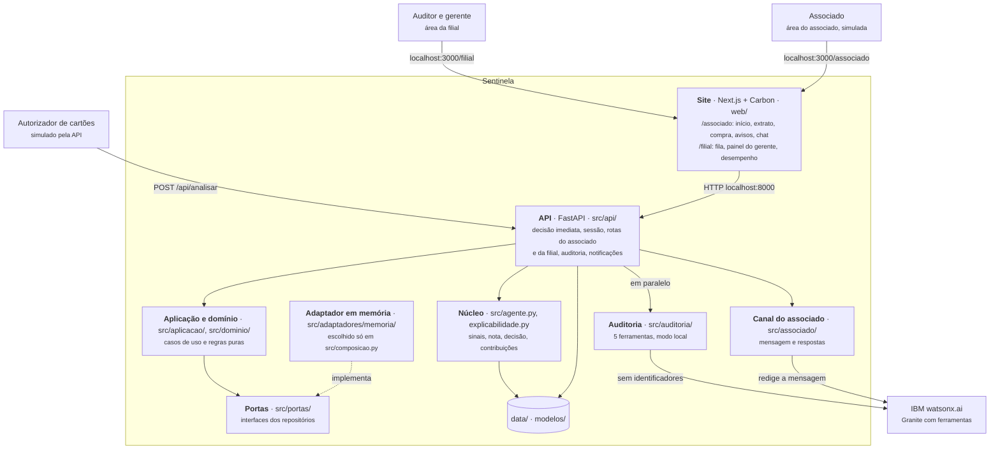
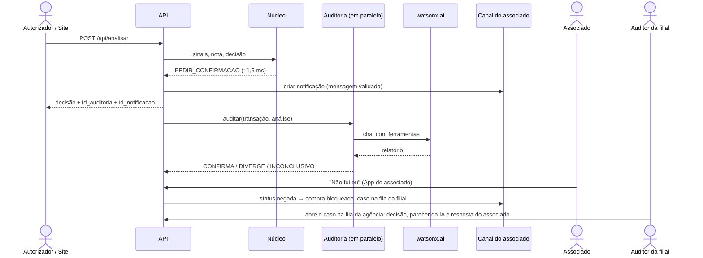

# Arquitetura

O modelo decide na hora; a IA audita em paralelo; o associado é avisado e responde; a filial
acompanha (ADR-011, ADR-012 e ADR-015). O site tem duas áreas: a do associado e a da filial
(auditor e gerente), cada uma vendo só o que pode (ESPECIFICACAO, seção 17). Tudo roda na máquina de quem usa, com dados
sintéticos; só a auditoria sai para o IBM watsonx.ai, sem identificadores.

## Contêineres

| Pasta | Responsabilidade |
| --- | --- |
| `src/` (raiz) | Dados, modelo, agente, fila e respostas do analista |
| `src/api/` | Rotas (`app.py`), esquemas, serviços, auditorias e respostas |
| `src/auditoria/` | Ferramentas, cliente do watsonx.ai, modo local, relatório e parecer |
| `src/associado/` | Notificações e mensagem ao associado (Issue #62) |
| `src/dominio/`, `src/aplicacao/` | Entidades, regras puras e casos de uso do associado e da filial |
| `src/portas/`, `src/adaptadores/` | Interfaces dos repositórios e o adaptador em memória; `src/composicao.py` liga os dois |
| `web/app/` | Uma pasta por página: `associado/`, `filial/` e `entrar/` |
| `web/components/` | Componentes por página (`fila/`, `painel/`, `desempenho/`…) e `comuns/` |
| `web/lib/` | Cliente da API, tipos, textos, formatação, mocks |

## Uma compra suspeita, do começo ao fim

A auditoria e a notificação nunca atrasam a decisão. Sem credenciais do watsonx.ai, a auditoria
e a mensagem usam o modo local e o resto funciona igual.
