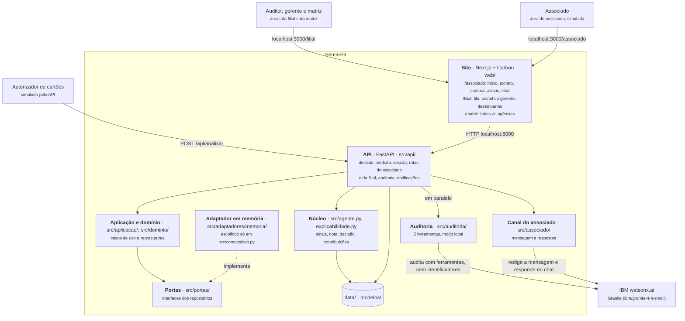
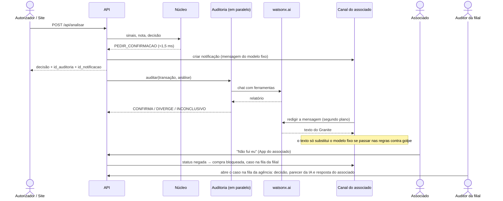

# Arquitetura

O modelo decide na hora; a IA audita em paralelo; o associado é avisado e responde; a filial
acompanha e a matriz compara as agências (ADR-011, ADR-012 e ADR-015). O site tem três áreas: a
do associado, a da filial (auditor e gerente) e a da matriz, cada uma vendo só o que pode
(ESPECIFICACAO, seção 17). Tudo roda na máquina de quem usa, com dados sintéticos. Só três coisas
saem para o IBM watsonx.ai, sempre sem identificadores: a auditoria da decisão, a redação da
mensagem ao associado e as respostas do chat.

## Contêineres

| Pasta | Responsabilidade |
| --- | --- |
| `src/` (raiz) | Dados, modelo, agente, fila de demonstração e scripts de análise e de retreino |
| `src/api/` | Rotas (`app.py`), esquemas, serviços, auditorias e respostas |
| `src/auditoria/` | Ferramentas, cliente do watsonx.ai, modo local, relatório e parecer |
| `src/associado/` | Notificações, mensagem redigida pelo Granite (com as regras contra golpe) e chat |
| `src/dominio/`, `src/aplicacao/` | Entidades, regras puras e casos de uso do associado, da filial e da matriz |
| `src/portas/`, `src/adaptadores/` | Interfaces dos repositórios, o adaptador em memória e o arquivo de rótulos para retreino; `src/composicao.py` liga os dois |
| `web/app/` | Uma pasta por área: `entrar/`, `associado/`, `filial/` e `matriz/` |
| `web/components/` | Componentes por área (`associado/`, `filial/`, `gerente/`, `matriz/`, `desempenho/`…) e `comuns/` |
| `web/lib/` | Cliente da API, tipos, textos, formatação, mocks |

## Uma compra suspeita, do começo ao fim

Passo a passo:

1. A API recebe a compra, calcula os 9 sinais e a nota, e decide na hora: aprovar, pedir
   confirmação ou bloquear.
2. Se a compra é suspeita, o canal do associado cria o aviso com a mensagem do modelo fixo. A
   decisão já volta a quem chamou, sem esperar a IA.
3. Em paralelo, a auditoria pede ao watsonx.ai que confira a decisão com 5 ferramentas. O parecer
   é CONFIRMA, DIVERGE ou INCONCLUSIVO e nunca muda a decisão.
4. Também em segundo plano, o Granite redige uma mensagem melhor para o associado. Ela só é usada
   se passar nas regras contra golpe: começa com "Sicredi:", tem até 160 caracteres, não tem
   link, nunca pede senha ou código e cita só o valor, a data e a hora reais da compra. Senão,
   vale o modelo fixo.
5. O associado responde "Fui eu" ou "Não fui eu" no app. "Não fui eu" bloqueia a compra; a
   resposta vira um rótulo guardado para retreino.
6. O auditor da agência abre o caso na fila, vê a decisão, o parecer da IA e a resposta do
   associado; se o associado ainda não respondeu, pode bloquear a compra. O gerente e a matriz
   acompanham os números.

A auditoria e a notificação nunca atrasam a decisão. Sem credenciais do watsonx.ai, a auditoria
e a mensagem usam o modo local (regra dos sinais e modelo fixo) e o resto funciona igual.
